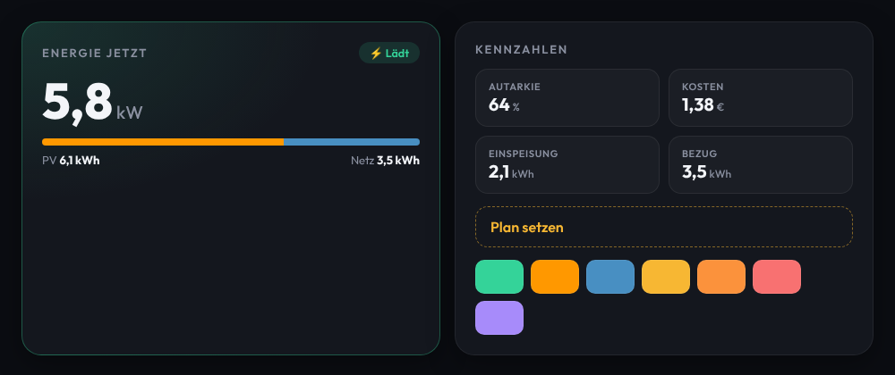

# Design

Das Design von ha-energyboard orientiert sich am Stil von
[glow-dashboard](https://github.com/deepblue120/glow-dashboard): dunkel, modern, kartenbasiert.
Eigene Werte und Code, keine Übernahme von dessen Quelltext.

Tokens: [`frontend/energyboard-tokens.css`](../frontend/energyboard-tokens.css) · Live-Vorschau: [`design-preview.html`](design-preview.html)

## Prinzipien

- **Dunkle Flächen, ein Akzent pro Aussage.** Hintergrund `#0b0d12`, Karten `#14171e`, Kacheln mit 3 % Weiß.
- **Farben tragen Bedeutung:** Grün = aktiv/OK, Orange (HA-Solarfarbe) = PV, Blau (HA-Netzfarbe) = Netz,
  Gold = Aktion/Plan, Orange-Rot = Warnung, Rot = Limit/Fehler.
- **Große Zahl, kleine Einheit.** Werte in 700–800, Einheit klein und gedämpft.
- **Titel in Versalien** mit weitem Buchstabenabstand, Labels in Versalien mit 0,06 em.
- **Weiche Formen:** Karten 22 px, Kacheln 14 px, Chips voll gerundet.
- **Glow nur für den aktiven Hauptzustand** (`eb-card--glow`), z. B. laufende Ladung.
- **Mobil (≤ 600 px):** kompaktere Karten, Details als aufklappbare Zeilen mit dem wichtigsten Wert.

## Typografie

[Outfit](https://fonts.google.com/specimen/Outfit) (OFL), Gewichte 500/600/700/800.
Die Schrift wird lokal mitgeliefert (`frontend/fonts/`, Variable Font als WOFF2 für Latin und Latin-Ext, Lizenz in `OFL-Outfit.txt`) und per `@font-face` in den Tokens eingebunden. Kein CDN, keine Verbindung zu Google.

## Komponenten

`eb-card`, `eb-card--glow`, `eb-title`, `eb-tile`, `eb-label`, `eb-value`, `eb-chip`, `eb-bar`, `eb-action`.
